<div align="center">


<a href="https://git.io/typing-svg">
  
</a>

<br/>


<br/>

[](https://codolio.com/profile/dharaniathananchayan)
[](https://www.linkedin.com/in/dharaniathananchayan/)
[](mailto:dharaniathananchayan@gmail.com)
[](https://github.com/dharaniathananchayan)

</div>

---

## 🟣 About Me

```yaml
Name:        Dharania
Role:        Software Engineer | Full Stack Developer | AI/ML Practitioner
Focus:       Building scalable, production-grade software with clean architecture
Currently:   Deepening expertise in Python, Django, and applied Machine Learning
Philosophy:  Engineering thoughtful, data-informed products — not just code
```

I'm a software engineer focused on building robust, scalable systems across the full stack — from backend architecture and REST APIs to data pipelines and machine learning models. My work blends **product engineering thinking** with a strong grounding in **Python, Django, and modern AI/ML tooling**, aiming to ship software that is maintainable, performant, and genuinely useful.

**🎯 Open To:** Software Engineering Roles · AI/ML Engineering · Full Stack Development · Data Science Collaborations · Open Source Contributions

---

## 🟣 Tech Stack

**Languages**

<table>
  <tr>
    <td align="center" width="96">
      
      <br/><sub><b>Python</b></sub>
    </td>
    <td align="center" width="96">
      
      <br/><sub><b>Java</b></sub>
    </td>
    <td align="center" width="96">
      
      <br/><sub><b>JavaScript</b></sub>
    </td>
    <td align="center" width="96">
      
      <br/><sub><b>TypeScript</b></sub>
    </td>
    <td align="center" width="96">
      
      <br/><sub><b>SQL</b></sub>
    </td>
  </tr>
</table>

**Frontend**

<table>
  <tr>
    <td align="center" width="96">
      
      <br/><sub><b>React</b></sub>
    </td>
    <td align="center" width="96">
      
      <br/><sub><b>HTML5</b></sub>
    </td>
    <td align="center" width="96">
      
      <br/><sub><b>CSS3</b></sub>
    </td>
    <td align="center" width="96">
      
      <br/><sub><b>Tailwind CSS</b></sub>
    </td>
    <td align="center" width="96">
      
      <br/><sub><b>Bootstrap</b></sub>
    </td>
    <td align="center" width="96">
      
      <br/><sub><b>jQuery</b></sub>
    </td>
  </tr>
</table>

**Backend & Databases**

<table>
  <tr>
    <td align="center" width="96">
      
      <br/><sub><b>FastAPI</b></sub>
    </td>
    <td align="center" width="96">
      
      <br/><sub><b>Django</b></sub>
    </td>
    <td align="center" width="96">
      
      <br/><sub><b>Flask</b></sub>
    </td>
    <td align="center" width="96">
      
      <br/><sub><b>PostgreSQL</b></sub>
    </td>
    <td align="center" width="96">
      
      <br/><sub><b>MySQL</b></sub>
    </td>
    <td align="center" width="96">
      
      <br/><sub><b>MongoDB</b></sub>
    </td>
    <td align="center" width="96">
      
      <br/><sub><b>SQLite</b></sub>
    </td>
  </tr>
</table>

**Data Analysis**

<table>
  <tr>
    <td align="center" width="96">
      
      <br/><sub><b>Pandas</b></sub>
    </td>
    <td align="center" width="96">
      
      <br/><sub><b>NumPy</b></sub>
    </td>
    <td align="center" width="96">
      
      <br/><sub><b>Matplotlib</b></sub>
    </td>
    <td align="center" width="96">
      
      <br/><sub><b>Power BI</b></sub>
    </td>
    <td align="center" width="96">
      
      <br/><sub><b>Tableau</b></sub>
    </td>
  </tr>
</table>

**AI / ML**

<table>
  <tr>
    <td align="center" width="96">
      
      <br/><sub><b>TensorFlow</b></sub>
    </td>
    <td align="center" width="96">
      
      <br/><sub><b>PyTorch</b></sub>
    </td>
    <td align="center" width="96">
      
      <br/><sub><b>Scikit-learn</b></sub>
    </td>
    <td align="center" width="96">
      
      <br/><sub><b>OpenCV</b></sub>
    </td>
    <td align="center" width="96">
      
      <br/><sub><b>Keras</b></sub>
    </td>
  </tr>
</table>

**Tools**

<table>
  <tr>
    <td align="center" width="96">
      
      <br/><sub><b>Docker</b></sub>
    </td>
    <td align="center" width="96">
      
      <br/><sub><b>Git</b></sub>
    </td>
    <td align="center" width="96">
      
      <br/><sub><b>GitHub</b></sub>
    </td>
    <td align="center" width="96">
      
      <br/><sub><b>PyCharm</b></sub>
    </td>
    <td align="center" width="96">
      
      <br/><sub><b>VS Code</b></sub>
    </td>
    <td align="center" width="96">
      
      <br/><sub><b>Postman</b></sub>
    </td>
  </tr>
</table>

---

## 🟣 Featured Projects

<table width="100%">
  <tr>
    <td width="50%" valign="top">
      <h3 align="left">Skin Cancer Detection and Classification System Using CNN-SVM</h3>
      <p align="left">Dual-engine clinical diagnostic system combining fine-tuned MobileNetV2 CNN feature extraction and RBF-SVM classification for HAM10000 skin lesion analysis with 94.17% binary accuracy.</p>
      <br/>
      <a href="https://github.com/dharaniathananchayan/skincancer-detection">
        
      </a>
    </td>
    <td width="50%" valign="top">
      <h3 align="left">SwiftSupport – Intelligent Customer Support & Automated Incident Resolution Platform</h3>
      <p align="left">AI-powered customer support and incident resolution platform featuring automated LLM ticket triage, smart agent dispatch, outage clustering, and real-time Prometheus/Grafana telemetry.</p>
      <br/>
      <a href="https://github.com/dharaniathananchayan/swiftsupport">
        
      </a>
    </td>
  </tr>
  <tr>
    <td width="50%" valign="top">
      <h3 align="left">CampusIQ – AI-Powered Campus Event Intelligence & Management Platform</h3>
      <p align="left">AI-powered campus event intelligence platform featuring sentence-transformer semantic matching (0–100%), real-time persistent Q&A forums, multi-turn AI co-pilots, and atomic capacity gating.</p>
      <br/>
      <a href="https://github.com/dharaniathananchayan/campusiq">
        
      </a>
    </td>
    <td width="50%" valign="top">
      <h3 align="left">ShopSense – AI-Powered Multi-Vendor E-Commerce & Retail Analytics Platform</h3>
      <p align="left">Multi-vendor e-commerce and retail analytics platform featuring Groq LLaMA-3.3-70B RAG shopping assistance, Text-to-SQL business intelligence, and ARIMA/Holt-Winters inventory forecasting.</p>
      <br/>
      <a href="https://github.com/dharaniathananchayan/shopsense">
        
      </a>
    </td>
  </tr>
  <tr>
    <td colspan="2" valign="top">
      <h3 align="left">Autonomous Document RAG & Conversational Knowledge Engine</h3>
      <p align="left">Context-grounded PDF document RAG engine combining LangChain ingestion, Pinecone dense vector indexing, and ultra-low-latency Groq LLaMA-3.3-70B inference with an interactive Streamlit UI.</p>
      <br/>
      <a href="https://github.com/dharaniathananchayan/rag-qa-system">
        
      </a>
    </td>
  </tr>
</table>
---

## 🟣 Experience

**Python Developer Intern**  
**archintX** · *Sep 2026 — Present* · `Remote / Chennai`

Architecting and maintaining Python backend services, streamlining database schemas, and building modular RESTful endpoints for scalable web applications.

- Architect and deploy modular RESTful API microservices using Python and FastAPI/Flask with strict schema validation
- Engineer relational database models and optimize complex SQL queries using SQLAlchemy to minimize response latencies
- Implement automated testing workflows with Pytest and standardize clean code practices adhering to PEP 8 standards

`Python` `FastAPI` `Flask` `SQLAlchemy` `PostgreSQL` `REST APIs` `Pytest` `Git`

<br/>

**Python Developer Intern (Virtual Internship 7.0)**  
**Infosys Springboard** · *Jul 2026 — Sep 2026* · `Virtual`

Designed and engineered ShopSense, an enterprise-grade AI-driven multi-vendor e-commerce platform and retail analytics engine.

- Engineered the multi-vendor ShopSense retail architecture featuring FastAPI asynchronous microservices and React 19
- Developed an autonomous AI suite integrating an inventory-grounded RAG shopping assistant and conversational Text-to-SQL business analyst via Groq Cloud LLaMA-3.3-70B
- Implemented predictive time-series demand forecasting using ARIMA and Holt-Winters statistical smoothing to calculate automated Reorder Points (ROP)

`Python` `FastAPI` `React 19` `Groq (LLaMA-3.3-70B)` `RAG` `Text-to-SQL` `ARIMA` `Docker` `Pytest`

<br/>

**AI Engineer Intern**  
**Rubixe AI Solutions** · *Completed* · `Remote / Chennai`

Contributed to machine learning lifecycles, developing data preprocessing pipelines, exploratory feature engineering, and model validation frameworks across client datasets.

- Constructed end-to-end exploratory data analysis (EDA) and data wrangling pipelines across structured tabular datasets and image corpuses using Pandas, NumPy, and OpenCV
- Trained, tuned, and evaluated supervised classification and regression models using Scikit-Learn with GridSearchCV hyperparameter optimization
- Established model evaluation frameworks (ROC-AUC, confusion matrices) and collaborated to containerize ML inference workflows for deployment

`Python` `Machine Learning` `Scikit-Learn` `OpenCV` `Pandas` `NumPy` `Feature Engineering` `Model Evaluation`

---

## 🟣 Contribution Activity

<div align="center">



<br/>

<!-- CONTRIBUTIONS_YEAR:START -->
<h3 align="center">117 Contributions in 2026</h3>
<!-- CONTRIBUTIONS_YEAR:END -->

<br/>



</div>

---

<div align="center">


</div>

---

## 🟣 What I'm Working Towards

I'm interested in building software that goes beyond functionality — systems that are intelligent, scalable, and thoughtfully engineered.

Currently deepening my understanding of backend engineering, applied machine learning, and Generative AI, while exploring how these technologies come together in real-world applications.

My current technical interests include:

- Designing scalable backend systems using Python, Django, FastAPI, and REST APIs.
- Building intelligent applications powered by LLMs, RAG, and vector databases.
- Developing end-to-end machine learning workflows, from experimentation to deployment.
- Exploring cloud infrastructure, Docker, CI/CD, and MLOps.
- Strengthening my understanding of system design and software architecture.

Outside my current projects, I'm always curious about emerging technologies, open-source ecosystems, and unconventional ways to solve engineering problems.

**🎯 Interested In:** Software Engineering · AI/ML · Backend Development · Generative AI · Open-Source Collaboration

---

## 🟣 Connect With Me

<div align="center">

[](mailto:dharaniathananchayan@gmail.com)
[](https://www.linkedin.com/in/dharaniathananchayan/)
[](https://github.com/dharaniathananchayan)
[](https://codolio.com/profile/dharaniathananchayan)

</div>

---

<div align="center">

*"Code is the craft — engineering is the discipline of making it matter."*


</div>
